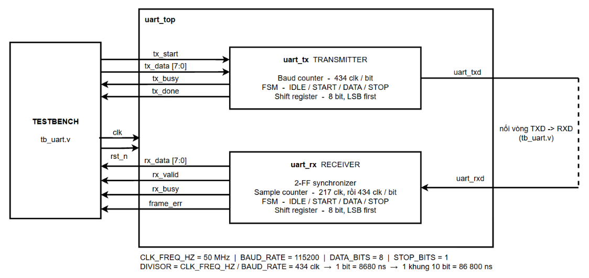
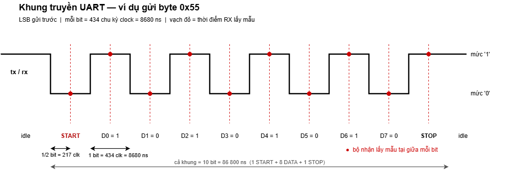
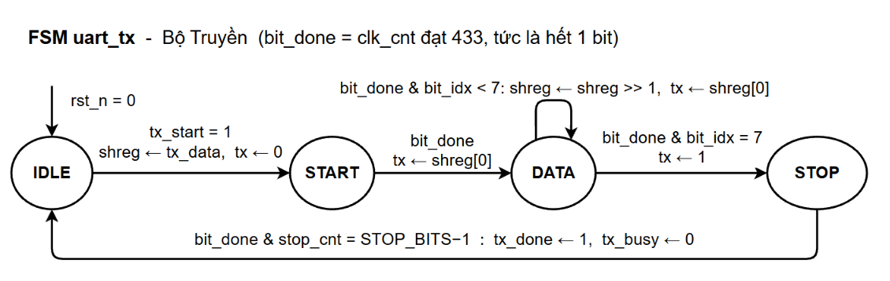
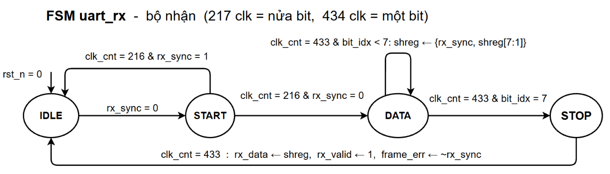
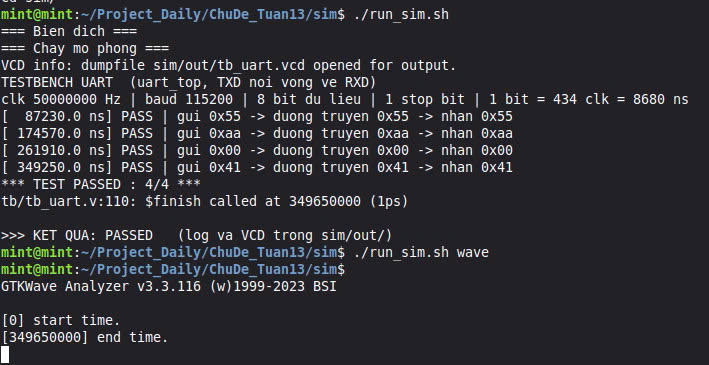
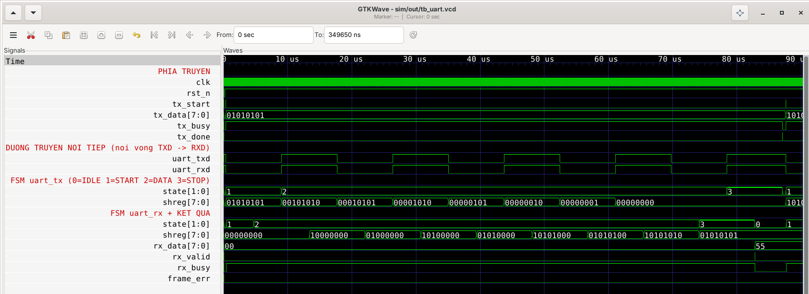
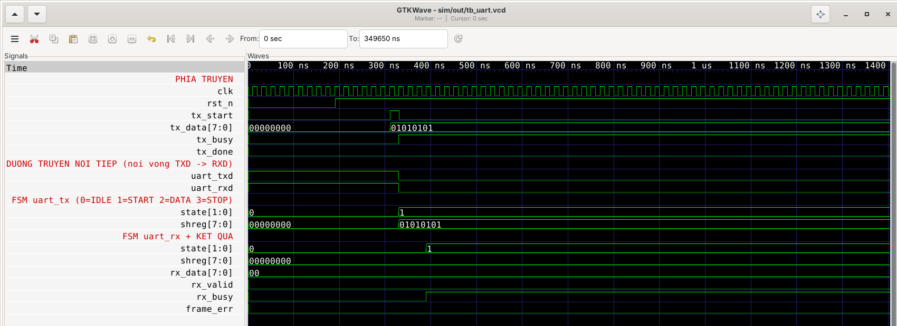
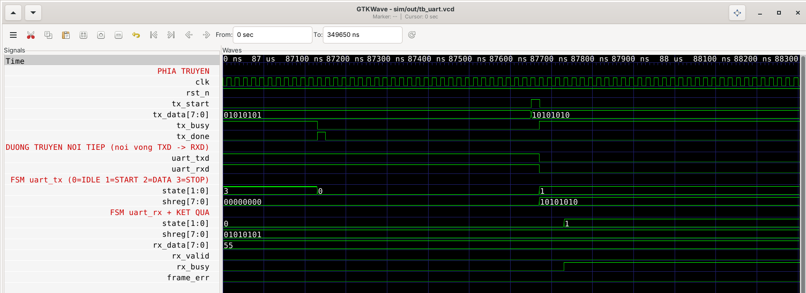

# Lab 6 — Thiết kế bộ điều khiển giao tiếp UART bằng Verilog

Bộ điều khiển UART full-duplex viết bằng Verilog-2001, mô phỏng và kiểm chứng
bằng Icarus Verilog và GTKWave trên Linux Mint.

Nội dung thực hiện:

- Nguyên lý truyền dữ liệu nối tiếp UART
- Thiết kế UART Transmitter và Receiver
- Thiết lập baud rate, start bit, data bit, stop bit qua tham số module
- Mô phỏng quá trình truyền nhận và kiểm tra dữ liệu

---

## 1. Cấu trúc thư mục

```
ChuDe_Tuan13/
├── README.md
│
├── rtl/                      Mã nguồn thiết kế
│   ├── uart_tx.v             Bộ truyền
│   ├── uart_rx.v             Bộ nhận
│   └── uart_top.v            Ghép TX + RX
│
├── tb/
│   └── tb_uart.v             Testbench
│
├── sim/                      Script mô phỏng
│   ├── run_sim.sh            Linux
│   ├── uart.mk               make -f sim/uart.mk
│   ├── run_sim.bat           Windows
│   ├── wave_uart.gtkw        Cấu hình tín hiệu cho GTKWave
│   └── out/                  Tự sinh khi chạy, không commit
│
└── docs/                     Sơ đồ và ảnh waveform
    ├── uart_block_diagram.png
    ├── uart_frame.png
    ├── uart_tx_fsm.png
    ├── uart_rx_fsm.png
    ├── log_result.jpg
    ├── wave_full_frame.png
    ├── wave_start.png
    └── wave_done.png
```

---

## 2. Cài đặt

```bash
sudo apt update
sudo apt install -y iverilog gtkwave make
chmod +x sim/run_sim.sh
```

---

## 3. Chạy mô phỏng

```bash
./sim/run_sim.sh          # biên dịch + chạy
./sim/run_sim.sh wave     # mở waveform
./sim/run_sim.sh clean    # xoá sim/out
```

Hoặc `make -f sim/uart.mk`

Kết quả:

```
=== Bien dich ===
=== Chay mo phong ===
TESTBENCH UART  (uart_top, TXD noi vong ve RXD)
clk 50000000 Hz | baud 115200 | 8 bit du lieu | 1 stop bit | 1 bit = 434 clk = 8680 ns
[  87230.0 ns] PASS | gui 0x55 -> duong truyen 0x55 -> nhan 0x55
[ 174570.0 ns] PASS | gui 0xaa -> duong truyen 0xaa -> nhan 0xaa
[ 261910.0 ns] PASS | gui 0x00 -> duong truyen 0x00 -> nhan 0x00
[ 349250.0 ns] PASS | gui 0x41 -> duong truyen 0x41 -> nhan 0x41
*** TEST PASSED : 4/4 ***

>>> KET QUA: PASSED   (log va VCD trong sim/out/)
```

Script trả mã thoát `0` khi đạt, `1` khi có lỗi. Nó chỉ kết luận đạt khi tìm
thấy dòng `*** TEST PASSED ***` trong log, nên mô phỏng crash hoặc treo rồi
timeout đều bị bắt.

---

## 4. Thiết kế



### 4.1. Tham số

| Tham số | Mặc định | Ý nghĩa |
|---|---|---|
| `CLK_FREQ_HZ` | 50 000 000 | Tần số clock hệ thống |
| `BAUD_RATE` | 115 200 | Tốc độ baud |
| `DATA_BITS` | 8 | Số bit dữ liệu |
| `STOP_BITS` | 1 | Số stop bit (chỉ `uart_tx` dùng) |

```
DIVISOR = CLK_FREQ_HZ / BAUD_RATE = 50 000 000 / 115 200 = 434 chu kỳ clock
1 bit   = 434 × 20 ns = 8680 ns
1 khung = 10 bit (1 START + 8 DATA + 1 STOP) = 86 800 ns
```

### 4.2. Khung truyền



Đường truyền ở mức `1` khi rảnh. Một khung gồm START bit mức `0`, các bit dữ
liệu **LSB gửi trước**, rồi STOP bit mức `1`.

### 4.3. uart_tx



Cả `uart_tx` và `uart_rx` đều viết theo kiểu **FSM tách 3 khối**:

| Khối | Loại | Nhiệm vụ |
|---|---|---|
| (1) | `always @(posedge clk)` | Thanh ghi trạng thái: `state <= next_state` |
| (2) | `always @(*)` | Logic trạng thái kế tiếp, chỉ tính `next_state` |
| (3) | `always @(posedge clk)` | Datapath và ngõ ra: bộ đếm, thanh ghi dịch, cờ |

Khối (2) gán `next_state = state` ngay đầu nên không sinh latch. Mọi thanh ghi
dùng `<=`, chỉ `next_state` dùng `=` vì là tín hiệu tổ hợp.

Mỗi trạng thái kéo dài đúng `DIVISOR` chu kỳ clock:

| Trạng thái | `tx` | Chuyển tiếp |
|---|---|---|
| `IDLE` | `1` | `tx_start` → `START` |
| `START` | `0` | hết 1 bit → `DATA` |
| `DATA` | `shreg[0]` | mỗi bit dịch `shreg >> 1`, đủ 8 bit → `STOP` |
| `STOP` | `1` | đủ `STOP_BITS` → `IDLE`, phát xung `tx_done` |

### 4.4. uart_rx



Chân `rx` là tín hiệu bất đồng bộ nên được cho qua **2 flip-flop** trước khi
dùng, tránh metastability.

Khi phát hiện cạnh xuống, bộ nhận đợi **217 chu kỳ clock (nửa bit)** rồi kiểm
tra lại: nếu vẫn là `0` thì đúng là START bit, và con trỏ thời gian lúc này nằm
ở **giữa** bit. Từ đó cứ mỗi 434 chu kỳ clock lấy mẫu một lần, nên mọi điểm lấy
mẫu đều rơi vào giữa ô bit — vị trí xa rìa nhất, chịu được sai lệch baud giữa
hai thiết bị. Nếu nửa bit sau vẫn thấy mức `1` thì đó chỉ là nhiễu, quay về `IDLE`.

STOP bit cũng được lấy mẫu: nếu không phải `1` thì bật cờ `frame_err`.

`uart_rx` không nhận tham số `STOP_BITS`. Nó chỉ kiểm tra stop bit đầu tiên rồi
về `IDLE`; các stop bit còn lại vẫn giữ đường truyền ở mức `1` nên không bị hiểu
thành START bit mới.

---

## 5. Kiểm chứng

Testbench `tb_uart.v` nối `uart_txd` thẳng về `uart_rxd` của `uart_top`, nên một
lần gửi kiểm tra được cả hai phía. Với mỗi byte, testbench:

1. Ra lệnh truyền, kích thích đặt 1 ns sau sườn lên để DUT lấy mẫu ở sườn kế tiếp
2. Tự giải mã khung trên đường truyền: lấy mẫu từng bit tại giữa ô bit, kiểm tra
   START = `0` và STOP = `1` — **kiểm tra bộ truyền**
3. So sánh `rx_data` với dữ liệu gốc — **kiểm tra bộ nhận**

Bốn byte được dùng:

| Byte | Lý do chọn |
|---|---|
| `0x55` | `0101_0101`, bit đổi dấu liên tục — dễ đọc nhất trên waveform |
| `0xAA` | `1010_1010`, đảo ngược của `0x55` |
| `0x00` | Biên: toàn `0`, kiểm tra STOP bit vẫn lên `1` |
| `0x41` | Ký tự `'A'`, một byte thực tế |

Mỗi dòng log thể hiện trọn chuỗi dữ liệu:

```
[  87230.0 ns] PASS | gui 0x55 -> duong truyen 0x55 -> nhan 0x55
```

Việc tự giải mã khung ở bước 2 quan trọng: nếu chỉ so `tx_data` với `rx_data`
thì một lỗi đối xứng ở cả hai phía — ví dụ cùng gửi và cùng nhận theo MSB-first
— vẫn cho kết quả đúng.

---

## 6. Kết quả chạy



## 7. Waveform

`uart_txd` và `uart_rxd` là hai đầu của **cùng một sợi dây** — testbench nối
vòng chúng lại, nên hai dòng này luôn giống hệt nhau. Thanh ghi dịch và
`tx_data` hiển thị dạng nhị phân để đọc trực tiếp từng bit, mã trạng thái FSM
hiển thị dạng số: `0 = IDLE, 1 = START, 2 = DATA, 3 = STOP`.

### Toàn bộ một khung dữ liệu



`tx_data = 01010101` nạp vào thanh ghi dịch, rồi hai thanh ghi chạy **ngược
chiều nhau**: phía truyền dịch phải đẩy từng bit ra dây
`01010101 → 00101010 → 00010101 → … → 00000000`, phía nhận nạp vào từ MSB
`00000000 → 10000000 → 01000000 → 10100000 → … → 01010101`. Cuối khung,
`rx_data` chốt `55` kèm xung `rx_valid`, `frame_err` giữ `0`.

### Phóng to lúc bắt đầu



`rst_n` nhả ở 210 ns, `tx_start` lên đúng một chu kỳ clock ở 310 ns, `uart_txd`
xuống `0` bắt đầu START bit. Để ý `state` phía nhận đổi **trễ hơn** phía truyền
hai nhịp clock — đó là độ trễ của hai flip-flop đồng bộ hoá chân `rx`.

### Phóng to lúc kết thúc



`tx_done` lên đúng một chu kỳ clock rồi xuống, `state` về `IDLE`. Sau đó
`tx_start` của khung kế tiếp được lấy mẫu ở sườn lên và `tx_data` đổi sang
`10101010`.
