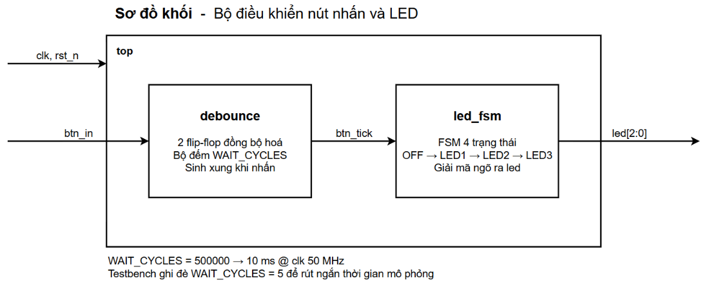
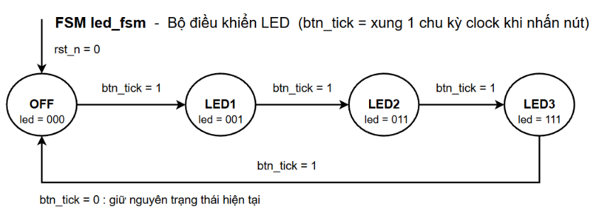
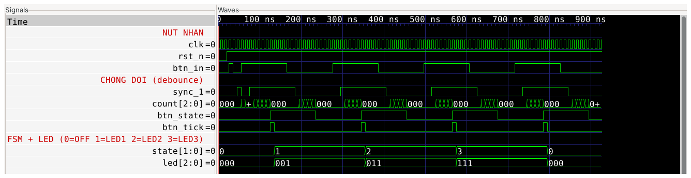
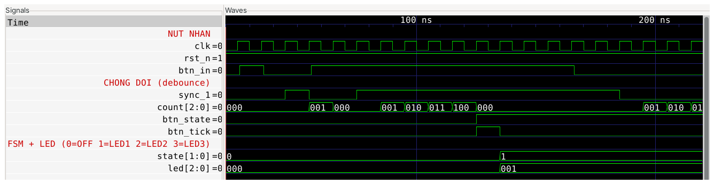
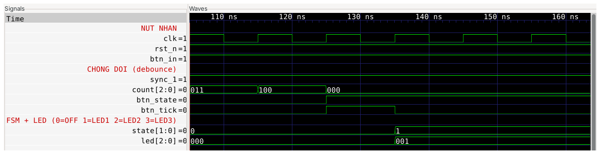

# Lab 10 — Thiết kế bộ điều khiển bàn phím và LED bằng FSM

Bộ điều khiển nút nhấn và LED viết bằng Verilog-2001, có mạch chống dội phím,
mô phỏng và kiểm chứng bằng Icarus Verilog và GTKWave trên Linux Mint.

Nội dung thực hiện:

- Nhận tín hiệu từ nút nhấn, lọc nhiễu dội phím
- Dùng FSM điều khiển trạng thái hoạt động
- Thiết kế mạch chống dội phím (debouncing)
- Mô phỏng và kiểm thử bằng testbench tự kết luận

---

## 1. Cấu trúc thư mục

```
ChuDe_Tuan14/
├── README.md
│
├── rtl/                      Mã nguồn thiết kế
│   ├── debounce.v            Chống dội phím
│   ├── led_fsm.v             FSM điều khiển LED
│   └── top.v                 Ghép hai khối
│
├── tb/
│   └── tb_top.v              Testbench
│
├── sim/                      Script mô phỏng
│   ├── run.sh                Linux
│   ├── run.bat               Windows
│   ├── wave.gtkw             Cấu hình tín hiệu cho GTKWave
│   └── out/                  Tự sinh khi chạy, không commit
│
└── docs/                     Sơ đồ và ảnh waveform
    ├── block_diagram.png
    ├── fsm_led.png
    ├── wave_overview.png
    ├── wave_debounce.png
    └── wave_tick.png
```

---

## 2. Cài đặt

```bash
sudo apt update
sudo apt install -y iverilog gtkwave
chmod +x sim/run.sh
```

---

## 3. Chạy mô phỏng

```bash
./sim/run.sh          # biên dịch + chạy
./sim/run.sh wave     # mở waveform
./sim/run.sh clean    # xoá sim/out
```

Kết quả:

```
=== Bien dich ===
=== Chay mo phong ===
TESTBENCH NUT NHAN + LED  (WAIT_CYCLES = 5)
[  266.0 ns] PASS | led = 001
[  486.0 ns] PASS | led = 011
[  706.0 ns] PASS | led = 111
[  926.0 ns] PASS | led = 000
*** TEST PASSED : 4/4 ***

>>> KET QUA: PASSED   (log va VCD trong sim/out/)
```

Script trả mã thoát `0` khi đạt, `1` khi có lỗi. Nó chỉ kết luận đạt khi tìm
thấy dòng `*** TEST PASSED ***` trong log, nên mô phỏng crash hoặc treo rồi
timeout đều bị bắt.

---

## 4. Thiết kế



### 4.1. Tham số

| Tham số | Mặc định | Ý nghĩa |
|---|---|---|
| `WAIT_CYCLES` | 500 000 | Số chu kỳ clock phải ổn định mới công nhận một lần nhấn |

```
WAIT_CYCLES = 500 000 × 20 ns = 10 ms  @ clk 50 MHz
```

Nút nhấn cơ dội trong khoảng 1 đến 20 ms nên cửa sổ 10 ms lọc được dội mà vẫn
đủ nhạy với người dùng. Tham số khai báo ở `top` rồi truyền xuống `debounce`,
testbench ghi đè `WAIT_CYCLES = 5` để rút ngắn thời gian mô phỏng.

### 4.2. debounce

Chân `btn_in` là tín hiệu bất đồng bộ nên được cho qua **2 flip-flop** trước
khi dùng, tránh metastability.

Mỗi khi mức đã đồng bộ khác với mức đang giữ, bộ đếm `count` tăng dần. Chỉ khi
đếm đủ `WAIT_CYCLES` chu kỳ liên tiếp mà mức vẫn khác thì mạch mới công nhận và
cập nhật `btn_state`. Nếu mức quay lại giữa chừng thì bộ đếm bị xoá về 0 và lần
thay đổi đó bị bỏ qua — đây chính là cơ chế lọc dội.

Khi mức mới được công nhận là `1`, mạch phát `btn_tick` cao **đúng một chu kỳ
clock**. Nhờ vậy FSM phía sau chỉ nhảy một bước cho mỗi lần nhấn, dù người dùng
giữ nút bao lâu.

### 4.3. led_fsm



FSM kiểu Moore, bốn trạng thái, ngõ ra `led` phụ thuộc trạng thái chứ không phụ
thuộc ngõ vào:

| Trạng thái | `led` | Chuyển tiếp |
|---|---|---|
| `OFF` | `000` | `btn_tick` → `LED1` |
| `LED1` | `001` | `btn_tick` → `LED2` |
| `LED2` | `011` | `btn_tick` → `LED3` |
| `LED3` | `111` | `btn_tick` → `OFF` |

Khối tổ hợp gán `next_state = state` ngay dòng đầu nên nhánh nào không ghi gì
thì tự giữ trạng thái cũ, không sinh latch. Thanh ghi dùng `<=`, riêng
`next_state` và `led` dùng `=` vì là tín hiệu tổ hợp.

---

## 5. Kiểm chứng

Testbench gửi bốn lần nhấn liên tiếp và sau mỗi lần so `led` với giá trị mong
đợi, đếm số lỗi rồi tự in kết luận. Trước lần nhấn đầu tiên có chèn một xung
nhiễu rộng 10 ns để chứng minh mạch chống dội hoạt động.

| Lần nhấn | `led` mong đợi |
|---|---|
| 1 | `001` |
| 2 | `011` |
| 3 | `111` |
| 4 | `000` |

Mọi kích thích đặt sau sườn lên clock 1 ns để tránh tranh chấp với thời điểm
thiết kế lấy mẫu. Một khối `initial` riêng đặt timeout 10 µs, nếu mô phỏng treo
thì vẫn in `*** TEST FAILED : timeout ***` chứ không treo im.

---

## 6. Waveform

### Toàn bộ bốn lần nhấn



`state` chạy `0 → 1 → 2 → 3 → 0` và `led` chạy `000 → 001 → 011 → 111 → 000`.
Mỗi lần chuyển đều đi kèm một xung `btn_tick` rộng đúng một chu kỳ clock.

### Lọc nhiễu dội phím



Xung nhiễu 10 ns ở đầu làm `count` nhích lên `001` rồi tụt ngay về `000`, không
sinh tick nào. Lần nhấn thật sau đó mới cho `count` đếm liền mạch
`001 → 010 → 011 → 100` rồi `btn_tick` mới bật.

### Thời điểm sinh xung



`count` đạt `100` tức `WAIT_CYCLES - 1`, `btn_state` lật lên `1`, `btn_tick`
cao đúng một chu kỳ rồi tự xuống, `state` sang `1` và `led` thành `001`.
